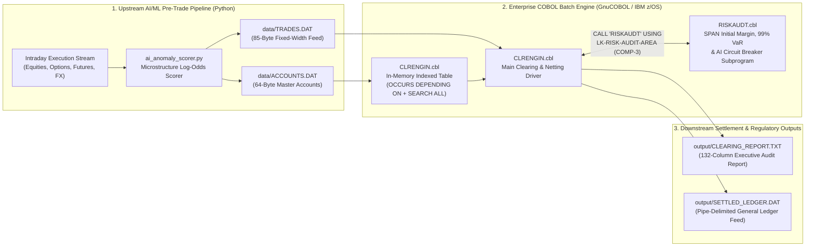

# `cobol-quant-clearing` — Prime Brokerage Clearing, SPAN Margin & Hybrid AI Risk Engine

[](.github/workflows/ci.yml)
[](#quantitative-risk--margin-methodology)
[](#system-architecture)

An enterprise-grade **COBOL + Python Hybrid Quantitative Clearing & Risk Engine** modeled after Tier-1 Prime Brokerage and Central Counterparty (CCP) settlement pipelines (such as DTCC, CME Clearing, and bulge-bracket custody/clearing engines running on IBM z16 mainframes).

---

## Why COBOL Matters in Modern Quant Finance, Banking & AI

While high-frequency alpha generation and feature engineering are written in Python, C++, or Rust, **post-trade clearing, margin netting, collateral management, and general-ledger settlement across Wall Street overwhelmingly execute in Enterprise COBOL on IBM Z mainframes**:

1. **Exact Fixed-Point Hardware Decimal Arithmetic (`COMP-3`):** IEEE-754 binary floating-point (`float`/`double`) cannot represent `0.01` exactly. Over millions of intraday trades, binary rounding drift violates regulatory audit trails. COBOL's `PIC S9(13)V9(02) COMP-3` (Packed Decimal) maps directly to hardware decimal instructions on IBM Z processors with zero binary conversion loss.
2. **Deterministic High-Throughput Batch & CICS Processing:** Clearing houses process hundreds of millions of multi-asset executions overnight within strict SLA windows using fixed-width sequential datasets, shared `COPYBOOK` schemas, and binary-searched in-memory master tables (`SEARCH ALL`).
3. **Hybrid AI on the Mainframe (IBM z16 Telum / ONNX Pattern):** Modern banks do not rewrite 40-year-old battle-tested COBOL clearing engines in Python. Instead, they run **real-time ML inference upstream (or on-chip via the IBM z16 Integrated Accelerator for AI)** to inject an anomaly/fraud probability (in basis points) directly into the fixed-width trade record, allowing the COBOL clearing engine to enforce deterministic circuit breakers before settlement.

---

## System Architecture



---

## Enterprise COBOL Features Demonstrated

| Enterprise COBOL Feature | File & Implementation | Why Recruiters & Mainframe Architects Care |
| :--- | :--- | :--- |
| **Shared `COPYBOOK` Data Contracts** | [`copybooks/TRADEREC.cpy`](copybooks/TRADEREC.cpy), [`copybooks/ACCTREC.cpy`](copybooks/ACCTREC.cpy), [`copybooks/RISKPARM.cpy`](copybooks/RISKPARM.cpy) | Enforces strict byte-level schema governance across batch programs, subprograms, and upstream feeds. |
| **Packed Decimal (`COMP-3`) Arithmetic** | [`src/RISKAUDT.cbl`](src/RISKAUDT.cbl), [`src/CLRENGIN.cbl`](src/CLRENGIN.cbl) | Uses `PIC S9(13)V9(02) COMP-3` with `COMPUTE ... ROUNDED` and `ON SIZE ERROR` overflow guards. |
| **Modular `CALL ... USING` Subprogram** | `CLRENGIN` $\rightarrow$ `CALL 'RISKAUDT' USING LK-RISK-AUDIT-AREA` | Separates I/O & portfolio aggregation from stateless quantitative pricing/risk logic via the `LINKAGE SECTION`. |
| **Binary Search Table (`SEARCH ALL`)** | `OCCURS 1 TO 50 TIMES DEPENDING ON ... ASCENDING KEY ... INDEXED BY ACCT-IDX` | Loads master accounts once into memory and performs $O(\log N)$ binary lookup per trade instead of slow disk I/O. |
| **88-Level Condition Names & `EVALUATE TRUE`** | `DECISION-CLEAR`, `DECISION-AI-HOLD`, `EVALUATE TRUE` decision matrix | Eliminates magic strings and deeply nested `IF/ELSE` trees in favor of self-documenting business rules. |
| **Production z/OS JCL Job Stream** | [`jcl/RUNCLEAR.jcl`](jcl/RUNCLEAR.jcl) | Includes `PGM=SORT` prerequisite step, `STEPLIB`, `DCB=(RECFM=FB,LRECL=...)`, and Generation Data Group (`GDG`) conventions. |

---

## Quantitative Risk & Margin Methodology

For every valid trade ticket, `CLRENGIN` invokes the subprogram `RISKAUDT` ([`src/RISKAUDT.cbl`](src/RISKAUDT.cbl)):

1. **Exact Trade Notional:**
   $$\text{Notional} = \text{Quantity} \times \text{Price}$$

2. **SPAN-Style Risk-Weighted Initial Margin:**
   Applies an asset-class risk weight $w_{\text{asset}} \in \{1.00\text{ (EQ)}, 1.85\text{ (OP)}, 1.40\text{ (FU)}, 0.50\text{ (FX)}\}$ to the client's base Reg-T requirement $r_{\text{base}}$ plus a $20\%$ realized-volatility surcharge:
   $$\text{Initial Margin} = \text{Notional} \times \left( r_{\text{base}} \cdot w_{\text{asset}} + 0.20 \cdot \sigma_{\text{annual}} \right)$$

3. **Parametric 1-Day 99% Value-at-Risk ($\text{VaR}_{99}$):**
   Uses the one-tailed $99\%$ standard normal quantile ($z_{0.99} = 2.3263$) and $\sqrt{252}$ trading-day scaling ($1/\sqrt{252} \approx 0.062994$):
   $$\text{VaR}_{99,\text{1D}} = \text{Notional} \times \sigma_{\text{annual}} \times \frac{1}{\sqrt{252}} \times 2.3263$$

4. **Hybrid AI/ML Circuit Breaker Matrix:**
   * **`REJT` (Hard Reject):** Single-ticket fat-finger notional $> \$50\text{M}$, frozen master account (`STATUS = 'F'`), or unrecognized account ID.
   * **`HOLD` (AI Quarantine):** Upstream ML anomaly probability $\ge 85.00\%$ (`8500` bps), OR elevated AI anomaly probability $\ge 65.00\%$ (`6500` bps) combined with institutional block notional $\ge \$5\text{M}$. Quarantined trades are logged for compliance review and excluded from net settlement exposure.
   * **`WARN` (Volatility Warning):** Cleared STP, but flagged when annualized asset volatility $\ge 55.00\%$ (`5500` bps).
   * **`CLRD` (Standard STP):** Cleared Straight-Through Processing into the client's net delta and margin buckets.

---

## Repository Structure

```text
cobol-quant-clearing/
├── copybooks/
│   ├── ACCTREC.cpy              # 64-byte Prime Brokerage Master Account record layout
│   ├── TRADEREC.cpy             # 85-byte Intraday Trade + AI Anomaly Score record layout
│   └── RISKPARM.cpy             # Linkage Section parameter block for CALL 'RISKAUDT'
├── src/
│   ├── CLRENGIN.cbl             # Main batch clearing, binary table lookup & EOD netting engine
│   └── RISKAUDT.cbl             # Stateless quantitative SPAN margin, VaR & AI audit subprogram
├── jcl/
│   └── RUNCLEAR.jcl             # IBM z/OS JCL job stream (DFSORT + CLRENGIN execution)
├── python/
│   ├── ai_anomaly_scorer.py     # Upstream ML log-odds anomaly scorer & fixed-width feed generator
│   └── verify_clearing_math.py  # Exact Decimal reference validator & local fallback runner
├── data/
│   ├── ACCOUNTS.DAT             # Generated 64-byte fixed-width master accounts
│   └── TRADES.DAT               # Generated 85-byte fixed-width intraday trade tickets
├── output/
│   ├── CLEARING_REPORT.TXT      # 132-column mainframe EOD clearing, VaR & margin call report
│   └── SETTLED_LEDGER.DAT       # Pipe-delimited downstream general ledger settlement feed
├── .github/workflows/ci.yml     # GitHub Actions CI compiling & running via GnuCOBOL
├── Dockerfile                   # Reproducible Debian + GnuCOBOL container
└── Makefile                     # One-command build & execution automation
```

---

## Quick Start

### Option 1: Native GnuCOBOL (`cobc`) on macOS / Linux

```bash
# Install GnuCOBOL (if not already installed)
brew install gnucobol   # macOS
# sudo apt-get install gnucobol  # Ubuntu/Debian

# 1. Run Python AI/ML scorer to generate fixed-width data/ACCOUNTS.DAT and data/TRADES.DAT
# 2. Compile src/CLRENGIN.cbl + src/RISKAUDT.cbl into bin/CLRENGIN
# 3. Execute batch and output reports
make all
```

### Option 2: Zero-Dependency Run (Without Local `cobc`)

If `cobc` is not installed locally, `make run` automatically executes the bit-exact fixed-point reference engine (`python/verify_clearing_math.py`), and GitHub Actions ([`.github/workflows/ci.yml`](.github/workflows/ci.yml)) compiles and verifies the native GnuCOBOL binary on every `git push`:

```bash
make run
cat output/CLEARING_REPORT.TXT
```

### Option 3: Docker

```bash
docker build -t cobol-quant-clearing .
docker run --rm cobol-quant-clearing
```

---

## Sample Output (`output/CLEARING_REPORT.TXT`)

```text
====================================================================================================================================
IBM Z16 // CICS-BATCH    TIER-1 PRIME BROKERAGE CLEARING, SPAN MARGIN & AI RISK ENGINE        JOB: CLRENGIN     RUN DATE: 2026-10-21
====================================================================================================================================
                                                                                                                                    
SECTION 1: INTRADAY TRADE EXECUTION, SPAN MARGIN & HYBRID AI/ML ANOMALY AUDIT LOG                                                   
------------------------------------------------------------------------------------------------------------------------------------
TRADE-ID   ACCOUNT  TICKER CL S    QUANTITY        PRICE     NOTIONAL ($) INIT MARGIN($)  1D-VAR-99($) AI-SC STAT AUDIT REASON      
------------------------------------------------------------------------------------------------------------------------------------
TRD2610001 PB000100 NVDA   EQ B      45,000     138.5000     6,232,500.00   1,333,755.00    292,265.24 17.96 CLRD STANDARD STP CLEAR
TRD2610002 PB000100 SPX    OP S       2,500   5,820.2500    14,550,625.00   4,576,171.56    394,473.91 20.23 CLRD STANDARD STP CLEAR
TRD2610003 PB000200 AAPL   EQ B      80,000     232.1500    18,572,000.00   3,101,524.00    571,535.06 15.92 CLRD STANDARD STP CLEAR
TRD2610004 PB000200 NDX    FU S       1,200  20,450.0000    24,540,000.00   5,496,960.00    881,060.13 25.39 CLRD STANDARD STP CLEAR
TRD2610005 PB000300 TSLA   OP B      22,000     260.7500     5,736,500.00   2,581,425.00    491,776.50 49.22 WARN EXTREME VOL REGIME
TRD2610006 PB000300 MSTR   EQ B      18,500     215.4000     3,984,900.00   1,211,409.60    362,054.56 47.63 WARN EXTREME VOL REGIME
TRD2610007 PB000400 MSFT   EQ B      65,000     428.8000    27,872,000.00   3,846,336.00    776,044.53 15.19 CLRD STANDARD STP CLEAR
TRD2610008 PB000500 EURUSD FX S   9,500,000       1.0845    10,302,750.00     916,944.75    143,430.55 08.96 CLRD STANDARD STP CLEAR
TRD2610009 PB000100 SMCI   OP B      95,000      48.9000     4,645,500.00   1,883,750.25    435,689.75 99.78 HOLD AI CIRCUIT BREAKER
TRD2610010 PB000500 USDJPY FX B      85,000     151.2500    12,856,250.00   1,697,025.00    584,037.74 76.67 HOLD AI ELEVATED + HIGH
TRD2610011 PB000400 AMZN   EQ B     320,000     195.0000    62,400,000.00   8,985,600.00  2,011,741.51 54.05 REJT SINGLE TICKET > $5
TRD2610012 PB000600 PARA   EQ B     150,000      11.2500     1,687,500.00           0.00          0.00 68.57 REJT ACCOUNT STATUS FRO
TRD2610013 PB999999 GME    OP B      50,000      24.5000     1,225,000.00           0.00          0.00 98.51 REJT UNKNOWN MASTER ACC
                                                                                                                                    
SECTION 2: END-OF-DAY PRIME BROKERAGE PORTFOLIO NETTING, COLLATERAL & MARGIN CALL STATEMENT                                         
------------------------------------------------------------------------------------------------------------------------------------
ACCOUNT  CLIENT INSTITUTION   TIER   GROSS EXPOSURE    NET DELTA ($)   REQ MARGIN ($)  POSTED COLL($)  EXCESS/DEFICIT  ACTION STATUS
------------------------------------------------------------------------------------------------------------------------------------
PB000100 CITADEL QUANT ALPHA  HFND    20,783,125.00 -    8,318,125.00    5,909,926.56    6,500,000.00 +     590,073.44 GOOD STANDING
PB000200 TWO SIGMA STAT ARB   HFND    43,112,000.00 -    5,968,000.00    8,598,484.00    9,200,000.00 +     601,516.00 GOOD STANDING
PB000300 JANE STREET DERIV    PROP     9,721,400.00 +    9,721,400.00    3,792,834.60    1,400,000.00 -   2,392,834.60 MARGIN CALL! 
PB000400 BLACKROCK GLOBAL EQ  INST    27,872,000.00 +   27,872,000.00    3,846,336.00    9,800,000.00 +   5,953,664.00 GOOD STANDING
PB000500 MILLENNIUM MACRO FX  HFND    10,302,750.00 -   10,302,750.00      916,944.75    3,100,000.00 +   2,183,055.25 GOOD STANDING
PB000600 ARCHEGOS LEGACY SWAP HFND             0.00 +            0.00            0.00      250,000.00 +     250,000.00 ACCT FROZEN  
------------------------------------------------------------------------------------------------------------------------------------
                                                                                                                                    
TOTAL INTRADAY TRADES PROCESSED       :          13    CLEARED GROSS NOTIONAL VOLUME :    $111,791,275.00                           
TRADES CLEARED STP (CLRD)             :           6    TOTAL SPAN INITIAL MARGIN REQ :     $23,064,525.91                           
TRADES CLEARED W/ VOL WARNING (WARN)  :           2    AGGREGATE 1-DAY 99% VAR       :      $3,912,640.48                           
TRADES QUARANTINED BY AI MODEL (HOLD) :           2    TOTAL MARGIN CALL DEFICIT ($) :      $2,392,834.60                           
TRADES HARD REJECTED (REJT)           :           3    ACCOUNTS ISSUED MARGIN CALLS  :              $1.00                           
====================================================================================================================================
```
